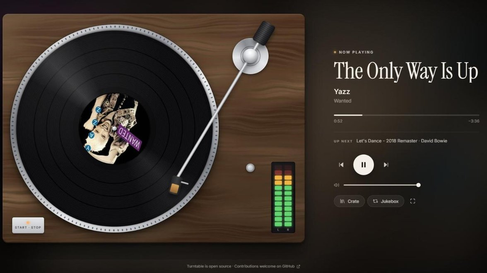
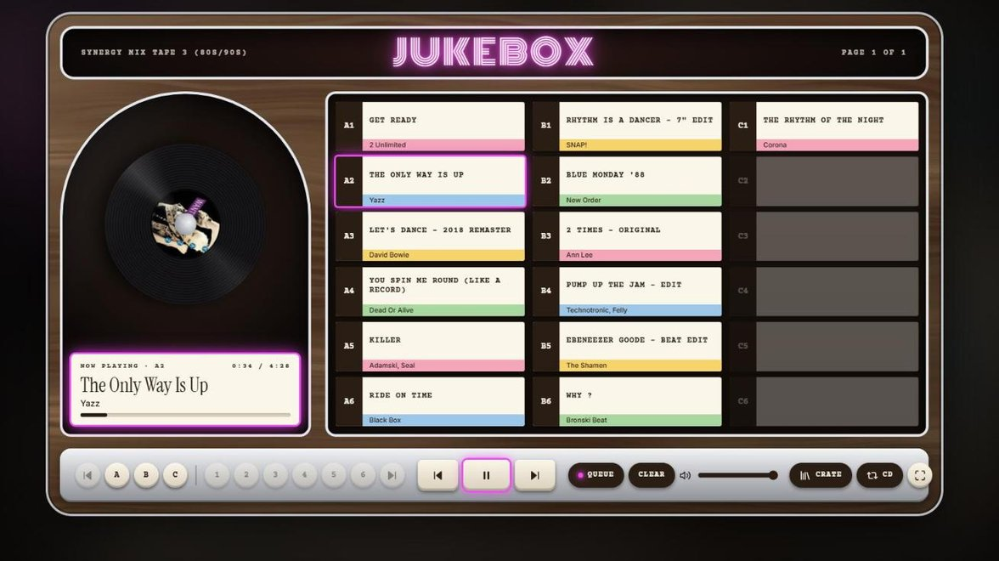
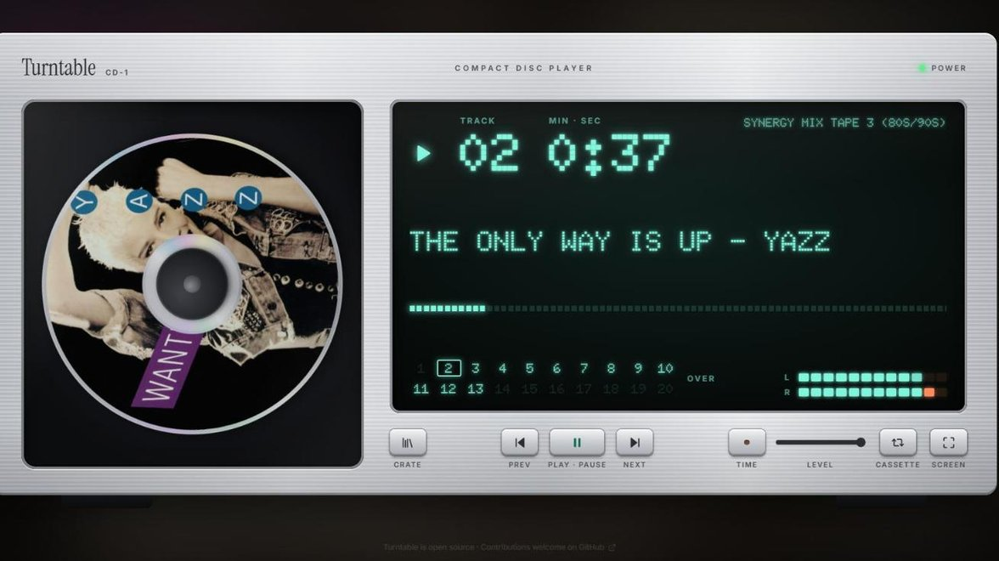
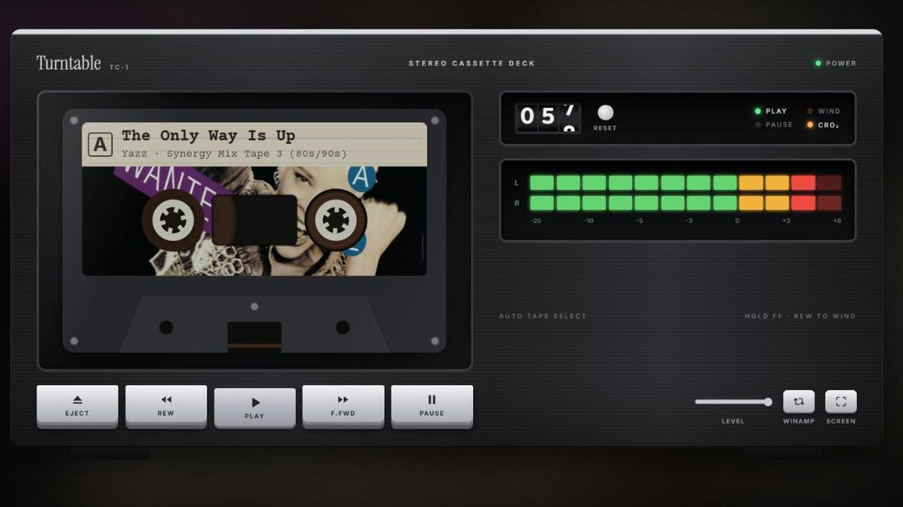
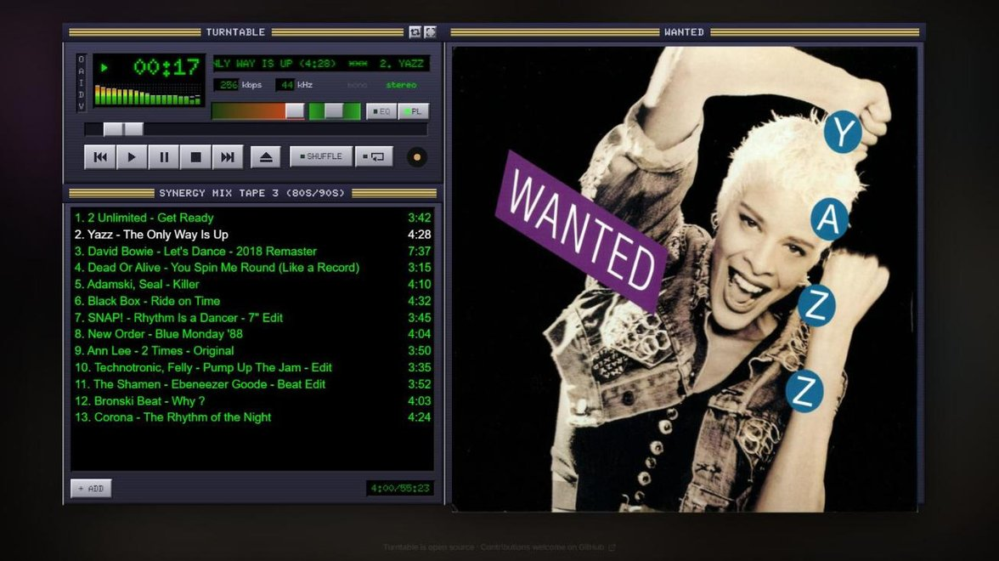

# Spotify Turntable

A fullscreen record player for a spare screen. Album art spins as the record label, the tonearm tracks progress, and your playlists and saved albums live in a slide-out crate. Press T to switch to a title-strip jukebox whose neon takes its colour from the record, again for a 90s hi-fi CD deck with the art printed on a spinning disc and a glowing fluorescent display, and once more for an 80s cassette deck: no skip buttons, just hold fast forward and see where you land. Press it a fifth time for a late-90s desktop MP3 player: green LCD, spectrum analyser, scrolling title and a playlist editor. Audio plays in the browser via Spotify's Web Playback SDK (Premium required).

**Try it: <https://thesecretstage.vip/spotifyTurntable/>** (you'll need your own free Spotify developer app; the page walks you through it).











## Setup

Everyone uses their own Spotify app (free to create). Spotify only lets an app in Development Mode be used by its owner and a few allowlisted people, so one shared app can't serve everybody. Premium is required.

**Hosted:** open <https://thesecretstage.vip/spotifyTurntable/>. On first run it walks you through creating the Spotify app, shows the redirect URI to paste into it, and asks for the Client ID, which stays in your browser. Choose **Install Turntable** from Chrome's menu to use it as an app.

**Local:**

1. `npm install` then `npm run dev`
2. Open <http://127.0.0.1:4545> (not `localhost`, Spotify rejects it) and follow the setup screen. Its redirect URI is `http://127.0.0.1:4545/`.

Optionally put a Client ID in `.env` (see `.env.example`) to skip the setup screen; a `.env` redirect URI overrides the default too.

## Publishing

`.github/workflows/pages.yml` builds and deploys to GitHub Pages on every push to `main`, without any Client ID. One-off: repo Settings → Pages → Source: **GitHub Actions**. It's served at <https://thesecretstage.vip/spotifyTurntable/> (the custom domain of the owner's GitHub Pages user site, so project repos appear under it by repo name). That exact address, trailing slash included, is the redirect URI people register. Pages needs a public repo (or a paid plan for private ones); Netlify and Cloudflare Pages work too, with `BASE_PATH=/` and `npm run build`.

## Keys

| Key | Action |
|---|---|
| Space | Play / pause |
| ← → | Previous / next track (cassette: hold to rewind / fast forward) |
| ↑ ↓ | Volume up / down |
| C | Open the crate |
| T | Next theme: turntable, jukebox, CD player, cassette deck, Winamp |
| Page Up / Down | Jukebox: previous / next page of strips |
| F | Fullscreen |
| L | Download the debug log |
| Esc | Clear the crate search, then close the crate |

Opening the crate focuses its search box: type to filter playlists and albums by name or artist (accents optional), Enter plays the top match. Click the record or the Start · Stop button to play/pause. Drag the tonearm, or click the progress bar, to seek. The VU meter on the plinth is for show: it pulses at a steady tempo picked per track rather than following the real audio, because Spotify's stream is DRM-protected and the page can't hear it. The deck drifts by about 1% of the screen over ~20 minutes so nothing static burns into an OLED. Cursor and controls hide after 3 s idle; the track details stay up.

## Run it as an app

```
npm run app            # build, start the local server, open the app window
npm run app:startup    # also start it whenever you sign in to Windows
npm run app:startup -- -Remove
```

`npm run app` serves the built site on 127.0.0.1:4545 in the background (Spotify's login must come back to that address, so a server has to be listening) and opens it in a borderless, fullscreen Chrome app window. Running it again reuses the server and focuses the existing window. The start-up shortcut skips the rebuild so sign-in stays quick; run `npm run app` after changing code.

For a Start menu and taskbar icon, open the app and choose **Install Turntable** from Chrome's menu (or the install icon in the address bar). Installed, the Power on click also takes it fullscreen.

It's a Chrome app rather than Tauri or plain Electron because Spotify's player needs Widevine DRM, which Chrome ships and Windows' WebView2 doesn't.

Plain kiosk mode still works too: `chrome --kiosk --app=http://127.0.0.1:4545`.

## Layout

```
src/
  spotify/auth.ts        PKCE login, token refresh, bring-your-own Client ID (no backend, no secret)
  spotify/api.ts         Typed Web API calls: library, playback, queue, jukebox strips
  player/                Web Playback SDK as a hook, position clock, jukebox strip list
  hooks/                 Fullscreen, wake lock, idle hide, album colour, theme, attract mode
  components/            Turntable, Jukebox, CdPlayer, Cassette, Winamp, VuMeter, NowPlaying, Transport, Crate, Setup, icons
  lib/                   Logger, small pure helpers (+ their tests)
  App.tsx                Wires it together; keyboard shortcuts live here
scripts/                 Windows launcher (npm run app), start-up shortcut, icon generator
.github/                 CI for PRs, Pages deploy, Dependabot
```

## Development

```
npm run dev     # http://127.0.0.1:4545, hot reload
npm run lint    # ESLint, including React's hook rules
npm test        # Vitest unit tests
npm run build   # type check + production build (adds the Content-Security-Policy)
npm run check   # all three, as CI runs them
```

Pull requests run the same checks in CI. Dependencies are pinned to exact versions; Dependabot proposes updates weekly.

Contributions are welcome: see [CONTRIBUTING.md](CONTRIBUTING.md) for setup, checks and ground rules.

## Notes for the .NET brain

- `useState` = a field whose change re-renders the component.
- `useEffect(fn, [deps])` = run `fn` when `deps` change; the returned function is `Dispose()`.
- `useRef` = a field that does *not* trigger re-render (holds the SDK player instance).
- Vite dev server = `dotnet watch`; `npm run build` = `dotnet publish` into `dist/`.

## Error handling

- `spotify/auth.ts` throws two typed errors: `AuthRequiredError` (log in again) and `NetworkError` (Spotify unreachable). A network blip never logs you out; only a rejected refresh token does. Concurrent refreshes are coalesced so the SDK and API can't race each other.
- `spotify/api.ts` retries 401 (refresh once), 429 (honours `Retry-After`) and 5xx (backoff), with a 10 s timeout per request. `transferPlayback` retries 404 because the device takes a moment to register.
- `player/useSpotifyPlayer.ts` times out if the SDK script never loads, checks `connect()`'s result and listens for `playback_error`. If the device drops mid-session it reconnects with backoff (1 s doubling to 30 s), stopping only on auth, Premium or DRM errors.
- `App.tsx` has one `report()` function that maps thrown errors to UI: auth → back to login, network → "lost contact" banner, anything else → dismissible notice. Offline state shows its own banner.
- `ErrorBoundary` catches render crashes and offers a reload.

## Debugging

`src/lib/log.ts` is a small structured logger. Every auth, API, player and UI failure writes a timestamped entry with a scope (`auth`, `api`, `player`, `app`, `render`, `window`). Entries go to the browser console with a `[turntable:scope]` prefix, and the last 500 are kept in localStorage across reloads.

- Press **L** to download the log as newline-delimited JSON.
- From devtools: `turntableLog.entries()`, `turntableLog.download()`, `turntableLog.clear()`.
- Uncaught errors and unhandled promise rejections are captured automatically.
- Nothing is sent anywhere; the log never contains tokens.

## Licence

[MIT](LICENSE). Not affiliated with or endorsed by Spotify.
